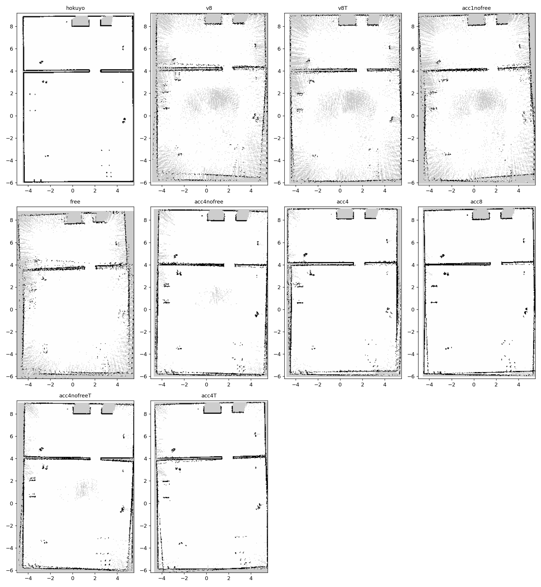
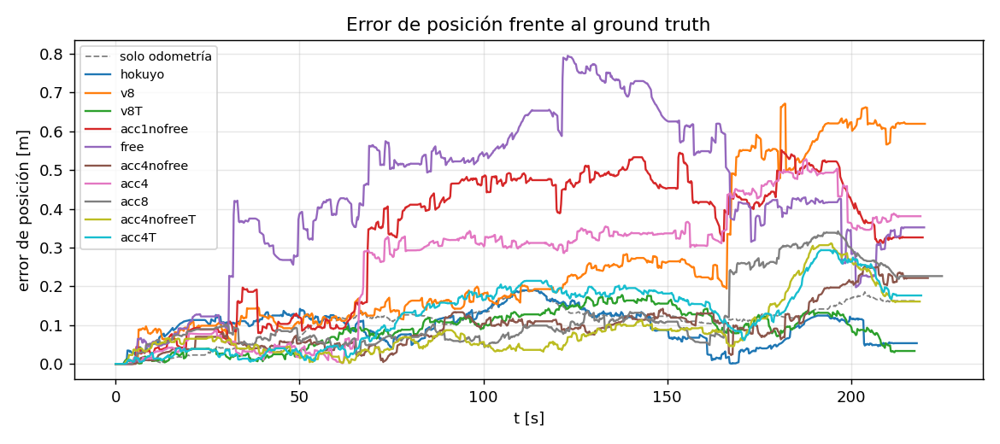
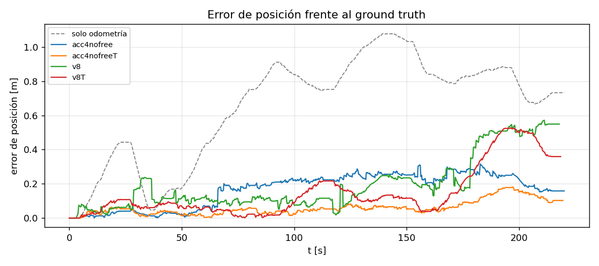
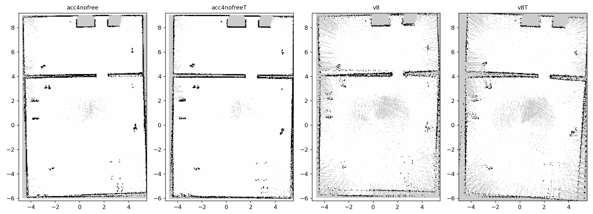

# Proyecto IA368 — Pepper: SLAM, entornos dinámicos e interacción por voz

Proyecto del curso **IA368 – Robótica** (Prof. Eric Rohmer), sobre la simulación de Pepper en
**ROS 2 Jazzy + Gazebo Harmonic** (Ubuntu 24.04).

La base del robot (modelo, sensores, mundos, slam_toolbox, Nav2, YOLO) está en
[`../Pepper-in-ROS2-Jazzy-and-Ubuntu-24`](../Pepper-in-ROS2-Jazzy-and-Ubuntu-24) y **no se
duplica aquí**: este repositorio sólo contiene lo nuevo del proyecto y reutiliza los launch y
configuraciones de la base.

| Fase | Objetivo | Estado |
|---|---|---|
| 1 | SLAM 2D con los **3 láseres bajos** de Pepper | ✅ primera versión (2026-10-15) |
| 2 | Objetos dinámicos en Gazebo (museo con personas en movimiento) | ✅ SLAM evaluado en el museo vacío, estático y dinámico; estelas y filtro dinámico (2026-10-20) |
| 3 | Un visitante llama a Pepper por voz → Pepper busca a la persona estática más cercana, se acerca y la mira | ✅ búsqueda, acercamiento con Nav2 y mirada: 10/10 llamadas (2026-10-20); voz probada de punta a punta con audio sintetizado (2026-10-21); falta el micrófono real |
| 4 | **Limpiar el escenario**: piso sucio que Pepper limpia al pasar, base de carga y autodocking (pedido del profesor) | ✅ todo el museo: 84 % limpio de media (87 % con gente caminando), 8/8 recargas en mitad de la misión (2026-11-16) |
| 5 | **Coger objetos**: Pepper va a una mesa, ve la manzana con la cámara y la coge con la mano (primer paso de "¿me traes una manzana?") | ✅ 36 de 40 intentos con la manzana en la mano (2026-11-18); falta pedirlo por voz y llevarla al visitante |

Presentación del proyecto (una pestaña por fase): [`docs/proyecto.html`](docs/proyecto.html),
publicada en **https://pepper-ia368.vercel.app**.

---

## Instalación

El workspace es `~/pepper_ws` (el mismo de la base). Esta carpeta se enlaza en `src/`:

```bash
ln -sfn ~/Robotica/Pepper-in-ROS2-Jazzy-and-Ubuntu-24 ~/pepper_ws/src/pepper     # base
ln -sfn ~/Robotica/2026-IA368II-Proyecto-Robotica    ~/pepper_ws/src/proyecto   # proyecto
cd ~/pepper_ws && colcon build --symlink-install
source install/setup.bash
```

---

## Fase 1 — SLAM con los 3 láseres de Pepper

### El problema

Pepper tiene tres láseres a ras de suelo (frontal, izquierdo y derecho), cada uno de **15 rayos
en ±30°** y hasta 7 m: 45 rayos en total, en tres sectores de 60° separados por huecos ciegos de
~30°. Es un sensor muy pobre para SLAM comparado con un lidar de 360°.

La base ya trae la fusión heredada del Tutorial V8 (`laser_publisher.py` → `/pepper/laser_2`),
y con ella slam_toolbox da un mapa reconocible pero punteado y con deriva. Analizando el código
de Karto (el motor de slam_toolbox, `karto_sdk/Karto.h`) se identificaron dos causas:

1. **Los rayos sin eco se publican como `NaN`, y Karto ignora los `NaN`.** El espacio libre sólo
   se marca a lo largo de los rayos que chocan con algo; en una sala grande la mayoría de los 45
   rayos no tocan nada y el mapa queda lleno de zonas grises "desconocidas".
2. **Cada scan tiene como mucho 45 puntos.** El scan matching tiene muy poca información y,
   cuando Pepper avanza paralelo a una pared larga, la posición a lo largo de la pared queda mal
   condicionada: el SLAM "salta" y aparecen paredes dobles.

### La solución: `pepper_multilaser_slam`

| Pieza | Qué hace |
|---|---|
| `scan_fusion` (nodo) | Fusiona los 3 láseres en `/pepper/scan_fused` (360°, 1°/rayo, en `base_footprint`) con **acumulación temporal** (y, opcional, marcado de **espacio libre**) |
| `config/slam_sparse_lasers.yaml` | Ajustes de slam_toolbox para sensores dispersos; se cargan **encima** de la configuración de la base (sólo los parámetros que cambian) |
| `slam.launch.py`, `fusion_slam.launch.py` | slam_toolbox (lifecycle) con la config de la base + overrides; fusión + SLAM |
| `route_driver` | Recorrido automático y repetible por la oficina (19 puntos, ~220 s, con cierre de lazo) |
| `trajectory_recorder` | Graba pose real (ground truth de Gazebo), pose del SLAM y odometría |
| `evaluate` | Métricas de trayectoria y de mapa, tablas y figuras |
| `scripts/run_experiment.sh` | Un experimento completo sin interfaz: simulación → SLAM → recorrido → mapa |
| `odom_noise` (nodo) | Odometría degradada con errores sistemáticos (`/pepper/odom_noisy`, árbol de TF aparte `odom_noisy → base_noisy`) para evaluar el SLAM con una odometría realista |
| `demo.launch.py` + `rviz/multilaser_slam.rviz` | Demo visual: Gazebo + fusión + SLAM + RViz con los 3 láseres en color + ruta automática |

**Acumulación temporal** (lo que se usa por defecto). Los impactos de los últimos N scans se
guardan en el frame `odom` y se reproyectan a la pose actual del robot. Con N = 4 (0.64 s a
6.25 Hz) la odometría apenas acumula error en ese intervalo y el scan pasa de ≤45 a ≤180 puntos.
Más rayos con eco también significa más espacio libre trazado en el mapa.

**Espacio libre** (opción `free_space`, desactivada: **resultado negativo**). Karto trata un rayo
así al construir el mapa (`OccupancyGrid::AddScan`): `NaN` o `≥ range_max` → se ignora; entre
`max_laser_range` y `range_max` → se traza como libre sin obstáculo al final. La idea era
publicar los rayos sin eco a 7.5 m (con `range_max = 8 m` y `max_laser_range = 7 m`) para que
limpien el espacio libre. Funciona en el mapa, pero los experimentos mostraron que **empeora la
localización**, y el código lo explica: el scan matcher (`GridIndexLookup::ComputeOffsets`) usa
`GetPointReadings()` **sin filtrar** y sólo descarta `NaN`/`inf`, así que esas lecturas entran al
matching como obstáculos falsos a 7.5 m. Con un único `LaserScan` no se puede tener las dos
cosas en Karto.

**Ajuste de slam_toolbox.** Karto penaliza alejarse de la odometría con
`1 − 0.2·d² / distance_variance_penalty`. Con el valor por defecto (0.5) un salto de 25 cm sólo
pierde un 2.5 % de respuesta; `slam_sparse_lasers.yaml` lo baja a 0.02 (un salto de 20 cm
pierde un 40 %), reduce la ventana de búsqueda a ±0.15 m y duplica el buffer de scans.

### Uso

Demo con un solo comando (Gazebo, SLAM, RViz y la ruta automática). En RViz: láser izquierdo
rojo, frontal verde, derecho azul, `/pepper/scan_fused` blanco:

```bash
ros2 launch pepper_multilaser_slam demo.launch.py                 # ruta automática
ros2 launch pepper_multilaser_slam demo.launch.py route:=false    # mover a mano (/pepper/cmd_vel)
ros2 launch pepper_multilaser_slam demo.launch.py gui:=false      # sin ventana de Gazebo
```

Por piezas:

```bash
# Terminal 1: simulación (paquete base)
ros2 launch pepper_gazebo_plugin pepper_gazebo_plugin_in_office_CPU.launch.py
# Terminal 2: fusión + SLAM
ros2 launch pepper_multilaser_slam fusion_slam.launch.py                 # acc4, sin espacio libre, Karto ajustado
ros2 launch pepper_multilaser_slam fusion_slam.launch.py accumulate:=1 free_space:=false overrides:=none
# Terminal 3: RViz2 con el mapa (paquete base)
ros2 launch pepper_gazebo_plugin pepper_sensors_rviz.launch.py config:=pepper_sensors_map.rviz
# Terminal 4: mover a Pepper (o la ruta automática)
ros2 run rqt_robot_steering rqt_robot_steering                           # topic /pepper/cmd_vel
ros2 run pepper_multilaser_slam route_driver --ros-args -p use_sim_time:=true
# Guardar el mapa
ros2 run nav2_map_server map_saver_cli -f mi_mapa
```

### Experimentos

```bash
S=$(ros2 pkg prefix pepper_multilaser_slam)/share/pepper_multilaser_slam/scripts/run_experiment.sh
$S v8 results/v8_r1                  # línea base: /pepper/laser_2 de la base
$S hokuyo results/hokuyo_r1          # cota superior: hokuyo "falso" de 720 rayos
$S acc4nofree results/acc4nofree_r1  # fusión nueva (4 scans acumulados)
TUNED=1 $S acc4nofree results/acc4nofreeT_r1   # ... y slam_toolbox ajustado (lo recomendado)
ros2 run pepper_multilaser_slam evaluate results/*_r* --out results
# Con odometría degradada (medio | alto): el SLAM usa /pepper/odom_noisy
ODOM_NOISE=alto TUNED=1 $S acc4nofree results/ruido_alto/acc4nofreeT_r1
```

Métricas (`evaluate`):

- **ATE RMSE**: error cuadrático medio de posición del SLAM frente al ground truth de Gazebo
  (`/pepper/odom_groundtruth`), alineando la primera pose. También se da el de la odometría sola.
- **Precisión del mapa**: % de celdas ocupadas a ≤10 cm de una pared del mapa de referencia
  (el del hokuyo, `pepper_gazebo_plugin/map/office.yaml`, en el mismo frame).
- **Completitud**: % de celdas ocupadas de la referencia con una celda ocupada a ≤10 cm.
- **Área libre** conocida en m².

### Resultados (2026-10-15)

Oficina con personas, misma ruta de 19 puntos (~220 s), **3 repeticiones** por configuración
(1 en las exploratorias). `T` = slam_toolbox con `slam_sparse_lasers.yaml`. Media ± desviación.
Tabla completa y por corrida en [`results/summary.md`](results/summary.md).

| Configuración | n | ATE RMSE [m] | Error final [m] | Precisión mapa (% ≤10 cm) | Completitud (% ≤10 cm) | Área libre [m²] |
|---|---|---|---|---|---|---|
| hokuyo (720 rayos, referencia) | 3 | 0.075 ± 0.029 | 0.042 ± 0.010 | 94.0 ± 10.4 | 95.9 ± 2.7 | 137.7 ± 0.2 |
| **v8** (`laser_2`, línea base) | 3 | 0.587 ± 0.483 | 0.924 ± 0.605 | 52.9 ± 12.9 | 62.1 ± 7.2 | 115.9 ± 1.5 |
| v8T | 3 | **0.098 ± 0.013** | 0.105 ± 0.065 | **90.8 ± 4.7** | 88.8 ± 2.4 | 116.8 ± 0.3 |
| acc4nofree | 3 | 0.163 ± 0.044 | 0.188 ± 0.057 | 79.3 ± 7.6 | 85.0 ± 9.2 | 134.0 ± 0.7 |
| **acc4nofreeT** (recomendado) | 3 | 0.135 ± 0.035 | 0.198 ± 0.066 | 76.7 ± 6.9 | **92.1 ± 5.6** | **134.4 ± 0.1** |
| acc4 (con espacio libre) | 3 | 0.306 ± 0.038 | 0.338 ± 0.051 | 60.3 ± 9.1 | 74.5 ± 6.5 | 134.4 ± 0.3 |
| acc4T (con espacio libre) | 3 | 0.131 ± 0.032 | 0.106 ± 0.061 | 78.4 ± 12.5 | 86.5 ± 4.2 | 136.4 ± 0.8 |
| acc1nofree | 1 | 0.374 | 0.326 | 57.8 | 63.0 | 116.8 |
| free (acc1 + espacio libre) | 1 | 0.477 | 0.352 | 33.6 | 49.1 | 118.7 |
| acc8 (con espacio libre) | 1 | 0.156 | 0.226 | 75.3 | 92.3 | 137.8 |

La odometría sola tiene un ATE de ~0.15 m en todas las corridas (el ruido simulado es pequeño).




**Conclusiones**

1. **La línea base del V8 es inestable**: ATE 0.59 ± 0.48 m. En las 3 corridas el scan
   matching "salta" en algún momento (paredes dobles), y queda peor que la odometría sola.
2. **Ajustar Karto es lo que más mejora la localización.** Con `slam_sparse_lasers.yaml` el
   mismo `laser_2` baja a 0.098 ± 0.013 m (6× mejor, y 5× menos variable), cerca del hokuyo.
   El problema no era sólo el sensor: con la configuración por defecto Karto casi no penaliza
   alejarse de la odometría.
3. **La acumulación temporal mejora el mapa**: el área libre pasa de ~116 m² a ~134 m² (el
   hokuyo da 138), desaparecen las zonas grises del centro de la sala y la completitud sube a
   92 %. Sin ajustar Karto, también estabiliza la localización (0.59 → 0.16 m).
4. **Marcar el espacio libre con lecturas finitas es contraproducente en Karto** (0.16 → 0.31 m
   sin ajustar), por cómo el scan matcher usa las lecturas sin filtrar (ver arriba).
5. **Configuración recomendada: `acc4nofreeT`** (lo que lanza `fusion_slam.launch.py` por
   defecto): mapa casi tan completo como el del hokuyo con sólo los 3 láseres reales de Pepper,
   y localización de ~0.13 m. Si sólo importa la trayectoria, `v8T` es algo más preciso
   (0.10 m) pero deja ~18 m² de la sala sin explorar en el mapa.

### Resultados con odometría degradada (2026-10-17)

Con el ruido de la simulación la odometría sola ya tiene ~0.15 m de ATE, y el SLAM apenas la
mejora. El plugin de la base sólo suma ruido blanco de media cero a la velocidad, que se promedia
al integrar. Un robot real deriva sobre todo por **errores sistemáticos**, así que `odom_noise`
los añade a cada incremento de la odometría, en el marco del robot:

| Nivel | Escala de avance | Escala de giro | Deriva de orientación |
|---|---|---|---|
| medio | +1.5 % | +2.5 % | 0.001 rad/s |
| alto | +3 % | +5 % | 0.002 rad/s |

(La ruta suma 47 m y 25 rad girados; los niveles se calibraron offline sobre trayectorias ya
grabadas.) La odometría degradada vive en un árbol de TF aparte (`odom_noisy → base_noisy`,
porque un frame no puede tener dos padres): el SLAM y la acumulación de `scan_fusion` sólo ven
esa odometría. Misma ruta, 3 repeticiones. Tablas por corrida en
[`results/ruido_alto/summary.md`](results/ruido_alto/summary.md) y
[`results/ruido_medio/summary.md`](results/ruido_medio/summary.md).

| Ruido | Configuración | ATE odometría sola [m] | ATE SLAM [m] | Error final [m] | Precisión mapa | Completitud | Área libre [m²] |
|---|---|---|---|---|---|---|---|
| alto | v8 | 0.814 ± 0.030 | 0.222 ± 0.053 | 0.416 ± 0.146 | 67.4 %¹ | 82.7 %¹ | 120.0¹ |
| alto | v8T | 0.780 ± 0.051 | 0.146 ± 0.058 | 0.210 ± 0.144 | 72.2 ± 5.0 | 78.4 ± 1.7 | 119.7 ± 0.8 |
| alto | acc4nofree | 0.762 ± 0.059 | 0.279 ± 0.148 | 0.385 ± 0.401 | 64.2 ± 1.2 | 75.4 ± 1.0 | 137.3 ± 3.2 |
| alto | **acc4nofreeT** | 0.779 ± 0.046 | **0.113 ± 0.052** | 0.207 ± 0.120 | **83.8 ± 2.7** | **98.6 ± 0.4** | 136.7 ± 1.3 |
| medio | v8T | 0.294 ± 0.027 | 0.145 ± 0.040 | 0.206 ± 0.044 | 76.1 ± 9.1 | 79.7 ± 7.9 | 117.6 ± 0.4 |
| medio | **acc4nofreeT** | 0.299 ± 0.080 | 0.144 ± 0.073 | 0.183 ± 0.094 | 73.1 ± 13.7 | 88.4 ± 15.1 | 135.2 ± 1.2 |

¹ Media de 2 corridas: en `v8_r3` `map_saver_cli` no recibió `/map` a tiempo (su trayectoria sí
es válida y entra en el ATE).




**Conclusiones con odometría degradada**

1. **El SLAM corrige la deriva**: con ruido alto la odometría sola acaba en ~0.78 m de ATE y
   `acc4nofreeT` en 0.11 m (7× menos). El SLAM mantiene ~0.11–0.15 m aunque la odometría
   empeore 5×, porque los láseres anclan la pose al mapa.
2. **El ajuste de Karto sigue ayudando con una odometría mala** (0.28 → 0.11 m con la fusión
   nueva, 0.22 → 0.15 m con `laser_2`). Penalizar los saltos no significa copiar la odometría:
   el scan matching sigue corrigiendo la deriva lenta y sólo se le impiden los saltos grandes
   y ambiguos.
3. **Con ruido alto la configuración recomendada es la mejor en todo**: menor ATE y el mejor mapa
   (98.6 % de completitud frente a 78 % de `v8T`, y ~17 m² más de área libre).
4. Con ruido medio `acc4nofreeT` y `v8T` empatan en trayectoria (0.14 m); la fusión nueva sigue
   dando un mapa más completo.

**Limitaciones**: 3 repeticiones por configuración; un solo entorno y una sola ruta; los errores
de odometría son un modelo (escala + deriva), no medidos en un Pepper real. La "precisión del
mapa" penaliza tanto el ruido como cualquier desplazamiento global del mapa respecto a la
referencia. La ruta se sigue con el ground truth (protocolo experimental: todas las
configuraciones recorren el mismo camino; el SLAM no lo ve).

**Siguientes pasos posibles**: más repeticiones y otra ruta; exploración autónoma (fronteras +
Nav2) en vez de la ruta fija; probar en el museo con gente en movimiento (Fase 2), donde la
acumulación puede dejar "estelas" de personas.

---

## Fase 2 — Museo con personas en movimiento

### Origen

Los mundos vienen del workspace de la tesis de graduación (`pepper_sim_ws`, ROS 1 + Gazebo
Classic: `pepper_virtual/pepper_gazebo_plugin/worlds/museum*.world` y sus launch
`pepper_gazebo_plugin_museum*.launch`). El paquete `pepper_museum` los porta a Gazebo Harmonic:

| Pieza | Qué es |
|---|---|
| `worlds/museum.sdf` | museo ISCAS vacío |
| `worlds/museum_with_people.sdf` | museo + 23 personas estáticas |
| `worlds/museum_with_people_moving.sdf` | museo + 10 personas estáticas + **16 actores caminando** con las trayectorias de la tesis (2–8 waypoints, 10–31 s, en bucle) |
| `worlds/museum_test_people.sdf` | museo + 4 de las personas estáticas, en sus posiciones de la tesis (prueba de la Fase 3) |
| `models/citizen_extras_female_03_fixed` | copia de `female_03` con texturas de nombre único (ver abajo) |
| `tools/museum_floorplan.py` → `maps/museum_walls.txt` | plano 2D: la malla del museo cortada a 20 cm del suelo, en celdas de 10 cm |
| `models/iscas_museum` | malla y texturas del museo (modelo "ISCAS Museum" de Changkun Chai, de la antigua base de modelos de Gazebo; no estaba en el workspace de la tesis, se tomó de una copia en GitHub, `COONEO/neor_mini`) |
| `models/actor_walk` | animación `walk.dae` de los actores (de `gazebosim/gazebo-classic`, `media/models`) |
| `tools/convert_worlds.py` | conversor de los `.world` de la tesis a `.sdf` de Harmonic (regenera `worlds/`) |
| `launch/museum.launch.py` | Pepper en el museo con el launch de la base; Pepper aparece en (-1.5, 1) como en la tesis |

Las personas estáticas (`citizen_extras_*`) son los modelos que ya trae la base.

```bash
ros2 launch pepper_museum museum.launch.py                              # personas en movimiento
ros2 launch pepper_museum museum.launch.py world:=museum_with_people    # personas estáticas
ros2 launch pepper_museum museum.launch.py world:=museum gui:=false     # vacío, sin interfaz
```

### Cambios respecto a Gazebo Classic

- **Sin `ActorCollisionsPlugin`.** En Classic los actores no tenían colisión y los láseres de
  rayos los atravesaban; el plugin les daba colisión. En Harmonic los láseres de Pepper son
  `gpu_lidar` (por render) y **ven la malla del actor** sin plugin: con Pepper quieto, los rayos
  que tocan a los actores cambian de distancia entre scans. Los actores no chocan físicamente
  con el robot.
- **Altura de los actores:** en Harmonic el origen de `walk.dae` está en la cadera; con z = 0
  (como en la tesis) quedaban hundidos hasta el pecho. El conversor suma 1 m a la z de cada
  waypoint, como los ejemplos de gz-sim.
- **Arranque lento:** la malla del museo (8 MB) y los actores hacen que el arranque vaya a
  RTF ~0.02 y el spawner de la base agota su timeout con `joint_state_controller`. El launch lo
  reintenta y lo activa (sin él no hay `/pepper/joint_states` ni TF de brazos y cabeza).
  Con la GPU funcionando (driver NVIDIA para el kernel 7.0.0-38), el museo con los 16 actores
  arranca en ~25 s y corre a **RTF ≈ 1.0**.
- **Texturas con el mismo nombre:** Harmonic reutiliza las texturas por nombre de archivo, y
  `citizen_extras_female_03` comparte nombres con `male_03` (cara ↔ camisa a cuadros) y con
  `female_02` (ropa ↔ vestido negro): se veía con la camisa en la cara y vestida de negro. El
  conversor usa la copia `citizen_extras_female_03_fixed`; el modelo de la base (también en la
  oficina) sigue igual.

### Experimentos en el museo

Las herramientas de la Fase 1 aceptan el mundo como parámetro:

```bash
# Experimento sin GUI: WORLD = office (por defecto) | museum | museum_with_people | museum_with_people_moving
WORLD=museum_with_people_moving TUNED=1 pepper_multilaser_slam/scripts/run_experiment.sh acc4nofree results/museo/dinamico/acc4nofreeT_r1
# ... con el filtro de objetos en movimiento de scan_fusion
WORLD=museum_with_people_moving TUNED=1 DYN=1 pepper_multilaser_slam/scripts/run_experiment.sh acc4nofree results/museo/dinamico/acc4nofreeTD_r1
# Evaluación frente al mapa del hokuyo en el museo vacío, y estelas
ros2 run pepper_multilaser_slam evaluate results/museo/dinamico/*_r? --ref pepper_museum/maps/museum_hokuyo.yaml --out results/museo/dinamico
python3 pepper_museum/tools/trails.py pepper_museum/maps/museum_hokuyo.yaml pepper_museum/worlds/museum_with_people_moving.sdf results/museo/dinamico/*_r?
# Demo visual en el museo
ros2 launch pepper_multilaser_slam demo.launch.py world:=museum_with_people_moving route_delay:=45
```

| Pieza nueva | Qué hace |
|---|---|
| `route_driver` `route:=museum` | 13 puntos, ~58 m: sube a la sala de arriba a la izquierda, cruza por arriba del bloque central, baja por x = 7 (donde caminan actores), vuelve por el pasillo inferior y cierra el lazo en el inicio. A ≥ 0.75 m de las paredes y ≥ 1 m de todas las personas de los tres mundos |
| `maps/museum_hokuyo.yaml` | el museo vacío mapeado con el hokuyo por esa ruta (ATE 0.074 m; 94.6 % de sus celdas a ≤ 15 cm del plano de la malla). Referencia de `evaluate` y mapa de Nav2 de la Fase 3 |
| `scan_fusion` `dynamic_filter` | rejilla en `odom` con el último instante en que cada celda fue atravesada por un rayo; un impacto en una celda vista libre hace < 5 s es algo que apareció (se descarta) y un impacto acumulado por el que ya pasó un rayo se borra (la persona se fue) |
| `tools/trails.py` | celdas del mapa que no están en la referencia, repartidas entre "junto a actores" (estelas), "junto a personas estáticas" y "otras" (error del SLAM) |

### Resultados en el museo (2026-10-20)

3 repeticiones por configuración (detalle y conclusiones en
[`results/museo/summary.md`](results/museo/summary.md)):

| Mundo | Config. | ATE SLAM [m] | Error final [m] | ATE odometría [m] | Estela [m²] |
|---|---|---|---|---|---|
| vacío | acc4nofreeT | 0.40 ± 0.18 | 0.15 | 0.19 | — |
| vacío | v8T | 0.53 ± 0.35 | 0.25 | 0.17 | — |
| estático | acc4nofreeT | 0.31 ± 0.07 | 0.15 | 0.18 | — |
| dinámico | acc4nofreeT | 0.41 ± 0.05 | 0.09 | 0.16 | **≈ 1.0** |
| dinámico | acc4nofreeTD (filtro) | 0.47 ± 0.08 | 0.31 | 0.15 | **≈ 0.1** |
| dinámico | v8T | 0.36 ± 0.23 | 0.50 | 0.18 | ≈ 0.3 |
| vacío, odometría con ruido alto | acc4nofreeT | **0.18 ± 0.14** | 0.15 | **1.22** | — |

1. **El tamaño del museo pesa más que la gente.** Con la odometría simulada (poco ruidosa), el
   SLAM con los láseres de Pepper (7 m, 45 rayos) se desvía a mitad de ruta en los tramos
   abiertos: las trayectorias se "encogen" ~0.4 m, como en un pasillo sin referencias a lo largo.
   Su ATE es peor que el de la odometría sola, aunque el cierre de lazo deja un error final menor.
2. **Con odometría mala el SLAM es imprescindible:** 1.22 m de la odometría frente a 0.18 m.
3. **La gente que camina deja estelas, y la acumulación las triplica** (≈ 1 m² frente a ≈ 0.3 m²).
4. **El filtro dinámico las elimina**, pero no mejora la localización y quita algo de mapa real y
   parte de las personas quietas (los láseres, bajos, ven entre sus piernas).


---

## Fase 3 — Un visitante llama, Pepper acude

Hablar por el micrófono del PC representa a un visitante **cercano** que llama a Pepper para
preguntarle sobre el museo. Pepper debe buscar a su alrededor, elegir a la persona **estática**
más cercana (las que caminan son la dificultad de SLAM y navegación, no visitantes), acercarse a
~1 m y seguir mirándola hasta la siguiente pregunta. Si no hay nadie cerca, debe decirlo.

### Quiénes son los visitantes

Los mundos usan sólo tres modelos de persona, copiados: `male_03` (camisa a cuadros roja,
jeans), `female_02` (vestido negro) y `female_03` (chaqueta marrón, jeans). Las copias son
idénticas, así que la identidad es el modelo. La cara es mala señal en esta simulación (la
cabeza ocupa ~40 px a 2 m y ~25 px a 3 m, y Pepper a menudo ve a la gente de espaldas): el
reconocimiento usa el **cuerpo entero**, recortado por YOLO.

### Paquete `pepper_visitors`

| Pieza | Qué hace |
|---|---|
| `capture_dataset` | teletransporta a Pepper por el museo (`/world/default/set_pose`) y guarda la imagen de la cámara frontal + su pose ground truth |
| `tools/label_dataset.py` | YOLO11m detecta personas; cada caja se compara con la caja **proyectada** de cada visitante (pose de Pepper + cámara) → recorte etiquetado sin intervención. División por persona (test = visitantes que el modelo nunca vio) |
| `tools/train_classifier.py` | fine-tuning de `yolo11n-cls` (4 clases: 3 modelos + "otro" = actores) y línea base de color; pesos en `models/visitor_cls.pt` |
| `voice_listener` | micrófono (PipeWire) → frases por energía → Whisper large-v3-turbo en la GPU → `/pepper/voice/transcript` y, si hay palabra de llamada, `/pepper/visitor_call` |
| `visitor_approach` | al recibir `/pepper/visitor_call`: busca (cabeza + base), elige a la persona estática más cercana con la cámara de profundidad, va con Nav2 a 1 m y la sigue con la cabeza |
| `launch/visitors_demo.launch.py` | museo + Nav2 (AMCL en el mapa del museo de la Fase 2) + `visitor_approach` (+ `voice_listener` con `voice:=true`) |
| `tools/eval_approach.py` | evalúa las llamadas registradas frente al ground truth del mundo |
| `tools/voice_test.py` | prueba `voice_listener` sin micrófono: frases sintetizadas con Piper (llamadas y no llamadas, dos voces, ruido opcional) que suenan en un sumidero virtual de PipeWire |

```bash
# Dataset (con la simulación del museo corriendo con ese mundo)
ros2 run pepper_visitors capture_dataset --world museum_with_people --out datasets/visitors/raw/museum_with_people --n 900
ros2 run pepper_visitors capture_dataset --world museum_with_people_moving --out datasets/visitors/raw/museum_with_people_moving --n 400
# Etiquetado y entrenamiento (entorno de yolo_ros)
PY=~/pepper_ws/src/yolo_ros/yolo_ros/.venv/bin/python
$PY pepper_visitors/tools/label_dataset.py datasets/visitors/raw datasets/visitors/cls
$PY pepper_visitors/tools/train_classifier.py datasets/visitors/cls results/fase3/classifier
# Voz (usa ~/pepper_ws/venvs/voice: faster-whisper + CUDA 12)
ros2 run pepper_visitors voice_listener --ros-args -p device:=<node.name del micrófono en PipeWire>
```

El entorno de voz se crea con `uv venv --system-site-packages ~/pepper_ws/venvs/voice` e
instalando `faster-whisper nvidia-cublas-cu12 "nvidia-cudnn-cu12==9.*" brotli` (brotli propio
porque el del sistema es viejo para huggingface_hub).

### Resultados del clasificador (2026-10-18)

Dataset: 1300 capturas (900 con las 23 personas estáticas, 400 con los actores) → 2011 recortes
(train 1268, val 357, test 386). Test = 4 visitantes en sitios no vistos + actores.

| | Exactitud test | ≤ 2 m | 2–3.5 m | > 3.5 m | female_02 | female_03 | male_03 | otro |
|---|---|---|---|---|---|---|---|---|
| Línea base: histograma de color | 96.1 % | 100 % | 99.0 % | 92.5 % | 88.8 % | 100 % | 97.0 % | 97.6 % |
| **yolo11n-cls fine-tuning** | **97.7 %** | 98.6 % | 97.1 % | **97.7 %** | **98.9 %** | 96.0 % | 98.5 % | 97.6 % |

Con tres aspectos tan distintos, el color de la ropa ya acierta mucho; el fine-tuning se
justifica por la robustez **a distancia** (92.5 → 97.7 % a más de 3.5 m) y con el vestido negro.
Casi todos los errores son cajas con dos visitantes superpuestos; uno es un error de etiqueta
(un hombre estático marcado como actor). Métricas completas en `results/fase3/classifier/metrics.json`.

### Buscar, acercarse y mirar: `visitor_approach`

```bash
# Simulación + Nav2 (AMCL en maps/museum_hokuyo.yaml) + visitor_approach; voice:=true añade el micrófono
ros2 launch pepper_visitors visitors_demo.launch.py                                   # museum_test_people
ros2 launch pepper_visitors visitors_demo.launch.py world:=museum_with_people_moving x:=1.0 y:=4.3
# La llamada sin micrófono
ros2 topic pub --once /pepper/visitor_call std_msgs/String "data: hola pepper"
# Evaluación de las llamadas registradas (log_file:=...) frente al ground truth
python3 pepper_visitors/tools/eval_approach.py calls.jsonl pepper_museum/worlds/museum_with_people_moving.sdf
```

Al recibir `/pepper/visitor_call` (corre en el entorno de yolo_ros: `scripts/visitor_approach`):

1. **Barrido de cabeza** (HeadYaw 0, ±1, ±2 rad; `/pepper/Head_controller/command`) y luego
   **giro de la base 180°** (Spin de Nav2) para mirar la espalda: la cabeza deja ~64° sin ver.
2. En cada posición, ~2 s de **YOLO11m**; la posición de cada persona sale de la **cámara de
   profundidad**: su nube se proyecta en la imagen frontal (TF) y se toma el torso de la caja.
3. **Estática o andando:** asociación uno a uno entre frames; estática si ≥ 70 % de sus
   posiciones quedan a < 12 cm de la mediana. Se descarta la posición que cae sobre algo del
   **mapa del museo vacío** (una persona tapada por un pedestal: la profundidad mide el pedestal).
4. La **más cercana** a ≤ 6 m que el clasificador (votando con 5 recortes) no tome por "otro";
   su clase sirve para saludar ("Te veo, la persona de camisa a cuadros roja"). Si no hay nadie:
   "No veo a nadie cerca" en `/pepper/say`.
5. **Nav2** a 1 m de ella, de frente (si no se puede, otros ángulos alrededor), y la **sigue con
   la cabeza** hasta la siguiente llamada. Cada llamada queda en `log_file` (JSON).

### Resultados de la búsqueda y el acercamiento (2026-10-20)

Museo con 10 personas quietas y 16 caminando, una llamada desde cada una de 10 poses de arranque
(detalle y versiones anteriores en [`results/fase3/approach/summary.md`](results/fase3/approach/summary.md)):

| Llegó a ~1 m | Eligió la estática más cercana | Personas cercanas encontradas | Falsos estáticos | Error de posición (profundidad) | Distancia final | Tiempo por llamada |
|---|---|---|---|---|---|---|
| **10 / 10** | **9 / 10** (la otra: empate de 3 cm) | 22 / 22 | 0 | 0.16 m (máx. 0.33) | 1.04 m | 35 s |

Cuatro problemas encontrados en la evaluación y corregidos: personas a la espalda (búsqueda de
360°), una persona tapada por un pedestal (comprobación con el mapa), un actor que se colaba en la
pista de una persona quieta (asociación uno a uno + mayoría) y actores parados unos segundos en
las esquinas de su trayectoria (clase "otro"). Queda: el clasificador tomó a `female_03` por
`male_03` las dos veces que fue el objetivo (sólo afecta al saludo).

### Voz sin micrófono (2026-10-21)

`voice_listener` puede escuchar el monitor de un sumidero (`capture_sink:=true`) en vez de un
micrófono. `tools/voice_test.py` crea el sumidero `pepper_test_audio`, sintetiza con
[Piper](https://github.com/OHF-Voice/piper1-gpl) 6 llamadas y 4 frases que no lo son, en dos
voces (España y México), las reproduce ahí y mide lo que publica `voice_listener`:

```bash
# Piper (una vez): uv venv ~/pepper_ws/venvs/tts && uv pip install --python ~/pepper_ws/venvs/tts/bin/python piper-tts
#                  cd ~/pepper_ws/weights/piper && ~/pepper_ws/venvs/tts/bin/python -m piper.download_voices es_ES-davefx-medium es_MX-claude-high
ros2 run pepper_visitors voice_listener --ros-args -p device:=pepper_test_audio -p capture_sink:=true
python3 pepper_visitors/tools/voice_test.py [--snr 10]
# De punta a punta: la demo con la voz en el sumidero, y una frase
ros2 launch pepper_visitors visitors_demo.launch.py world:=museum_with_people_moving voice:=true device:=pepper_test_audio capture_sink:=true
pw-play --target pepper_test_audio datasets/voice_test/es_MX-claude-high_00.wav
```

| Condición | Llamadas detectadas | Falsas llamadas | Latencia |
|---|---|---|---|
| limpio | 12/12 | 0/8 | 1.15 s |
| ruido rosa, SNR 10 dB | 12/12 | 0/8 | 1.25 s |
| ruido rosa, SNR 5 dB | 11/12 | 0/8 | 1.41 s |

Con `hotwords: "Pepper"` (nuevo, por defecto) Whisper escribe bien el nombre el doble de veces
(10/18 frente a 4/18) sin falsas llamadas. De punta a punta, «Hola Pepper, ¿me puedes contar
algo de esta pieza?» en el museo con gente caminando: llamada 0.6 s después de la frase, y Pepper
frente a la persona estática más cercana (a su espalda) 39 s después de empezar a hablar.
Detalle en [`results/fase3/voice/summary.md`](results/fase3/voice/summary.md).

**Pendiente**: ajustar el nivel (`energy_factor`, `min_rms`) con el micrófono real.

---

## Fase 4 — Limpiar el museo y recargarse en la base

Pedido del profesor: añadir al proyecto la función de **limpiar el escenario**. Se trajo al museo
la tarea del curso de la Sección 2 (escena `dirty_evaluation3.ttt` de CoppeliaSim: un robot
aspiradora limpia un piso sucio al pasar por encima y vuelve a una base de carga siguiendo un haz
infrarrojo, `autodocking.py`). Paquete nuevo: **`pepper_cleaning`**.

### Qué hay

| Pieza | Qué hace |
|---|---|
| Base de carga (`models/charging_dock`, `config/dock.yaml`) | Esquina suroeste del museo, a 0.5 m de la pared oeste (inclinada): contacto en map (−4.60, −7.0). Elegida porque ninguna persona estática ni trayectoria de actor pasa a menos de ~2 m en los tres mundos. Panel con contactos y emisor IR (lo ven los láseres) y placa en el piso |
| `dock_station` | Emula el haz IR como el `charging_base_node` del curso: abanico de ±20° y 2.5 m; intensidad = 1 − d/2.5 y ángulo relativo **sólo cuando hay señal**; contacto cuando el frente de Pepper llega a los contactos |
| `battery_sim` | `/pepper/battery` (`BatteryState`): consume 0.02 %/s + 0.6 % por metro recorrido; carga 2 %/s en la base. Valores de demo (el Pepper real dura horas) |
| `autodock` | La máquina de estados de `autodocking.py`: Nav2 hasta delante de la base → busca el haz girando → sigue el haz → si lo pierde, gira hacia el último ángulo y, si no lo recupera, retrocede y vuelve a empezar → carga → sale. Se dispara cuando la batería baja de `max(20 %, 10 % + 1.4 · 0.6 %/m · distancia a la base)`: lejos de la base vuelve antes |
| `dirt_floor` | **Piso sucio**: 451 baldosas de 0.3 m (41 m²) en 5 zonas (`config/dirt.yaml`), sobre celdas libres del mapa y lejos de las personas estáticas. Una baldosa se limpia cuando el centro de Pepper pasa a < 0.25 m con el cepillo encendido (`/pepper/brush`), y desaparece de Gazebo |
| `cleaner` | **Limpieza por cobertura**: cada zona en zigzag (carriles cada 0.4 m) con Nav2 `NavigateThroughPoses`, cortando los carriles donde el costmap ve obstáculos (personas). Después hace un **repaso** de los huecos que no cubrió, según su propia memoria de cobertura (pose de AMCL). Si la batería baja, pausa, va a cargarse y **sigue donde se quedó**. Al terminar vuelve a la base |

Pepper **no sabe dónde está la suciedad**, como una aspiradora real: recorre la zona entera.
Ni la cobertura ni el repaso usan el ground truth. El ground truth sólo se usa para la física
simulada del cepillo, el haz IR y la batería.

**Detalle de implementación del piso sucio.** Con un modelo de Gazebo por baldosa (~450) el
renderizado de los sensores bajaba el factor de tiempo real de ~0.93 a ~0.35. Ahora cada zona es
una sola malla (OBJ) con una textura atlas, y al limpiar se regenera la malla de la zona (como
mucho una vez por segundo). La textura es ruido periódico (barro y polvo) mezclado con el gris del
piso en espacio lineal: lo limpio de una baldosa se ve igual que el piso (196/255 en la cámara de
Pepper, medido), así que no se notan bordes (`tools/make_dirt_textures.py`).

### Uso

```bash
# Demo con Gazebo y RViz (museo de prueba con 4 personas)
ros2 launch pepper_cleaning cleaning_demo.launch.py
ros2 launch pepper_cleaning cleaning_demo.launch.py world:=museum_with_people_moving battery:=45

# Órdenes
ros2 topic pub -w 1 --once /pepper/clean_cmd std_msgs/String "data: start"              # todo el museo
ros2 topic pub -w 1 --once /pepper/clean_cmd std_msgs/String "data: start sala_oeste"   # una zona
ros2 topic pub -w 1 --once /pepper/clean_cmd std_msgs/String "data: stop"
ros2 topic pub -w 1 --once /pepper/dock_cmd std_msgs/String "data: dock"                # ir a cargarse
ros2 topic pub -w 1 --once /pepper/battery/set std_msgs/Float32 "data: 15.0"            # batería baja
ros2 topic pub -w 1 --once /pepper/dirt/reset std_msgs/Empty "{}"                       # ensuciar de nuevo

# Corrida completa sin GUI con grabación (run.jsonl, summary.json, cleaning.png)
pepper_cleaning/scripts/run_cleaning.sh results/limpieza/<nombre> [mundo] [batería inicial]
```

Desde la app (pestaña **Limpieza**) o el chat: "limpia la sala oeste", "limpia el museo", "deja
de limpiar", "ve a cargarte", "¿cuánta batería tienes?". Gemini tiene las herramientas
`clean_area`, `stop_cleaning`, `charge` y `get_status`. Sin Gemini, el parser local reconoce las
mismas frases.

### Resultados (2026-11-16)

| Versión | Limpio | Sala oeste | Esquina base | Pasillo sur | Sala norte | Entrada | Tiempo (sim.) | Recorrido | Recargas en la misión |
|---|---|---|---|---|---|---|---|---|---|
| v1: sólo zigzag, mapa del láser | **80.9 %** | 98 % | 88 % | 87 % | 72 % | 69 % | 13.3 min | 151 m | 1 |
| v2: + repaso, mapa del láser | **92.9 %** | 98 % | 96 % | 99 % | 90 % | 83 % | 22.1 min | 223 m | 2 |
| final, corrida 1 | **85.7 %** | 100 % | 98 % | 88 % | 81 % | 75 % | 21.7 min | 214 m | 2 |
| final, corrida 2 | **84.8 %** | 100 % | 91 % | 86 % | 82 % | 75 % | 22.9 min | 218 m | 2 |
| final, corrida 3 | **81.5 %** | 77 % | 98 % | 88 % | 79 % | 73 % | 23.0 min | 217 m | 2 |
| **final, media de 3** | **84.0 %** | 92 % | 95 % | 87 % | 80 % | 74 % | 22.5 min | 216 m | 6 |
| final, museo con gente caminando | **87.1 %** | 100 % | 97 % | 92 % | 86 % | 69 % | 22.3 min | 215 m | 2 |

Mundo `museum_test_people` (4 personas quietas) salvo la última fila (`museum_with_people_moving`: 10
quietas y 16 caminando). Batería inicial 45 % para forzar recargas. v1 y v2 usaban el mapa del láser
(41 m² de suciedad); las finales, el mapa de navegación con los salientes (39 m², 38 m² con la gente
caminando). Detalle por corrida: `results/limpieza/*/summary.json` y `cleaning.png`.

| Zona | sala_oeste | esquina_base | pasillo_sur | sala_norte | entrada |
|---|---|---|---|---|---|
| RMSE de AMCL (media de las 3) | 0.13 m | 0.15 m | 0.14 m | 0.26 m | 0.23 m |

- **El repaso suma ~12 puntos** (v1 81 % → v2 93 %): bordes y tramos que Nav2 abandonó.
- **8 de 8 recargas en mitad de la misión** salieron bien: pausa, Nav2 hasta la base, haz, carga,
  salida y vuelta al mismo tramo. Con la reserva según la distancia, desde la sala norte Pepper
  decidió volver con 22 % (con el umbral fijo de 20 % llegaba a la base con 8 %).
- **Lo que queda sucio es sobre todo localización**: en la sala norte y la entrada AMCL se
  equivoca ~0.24 m (0.13–0.15 m en el resto). Pepper recorre los carriles donde cree estar, la
  pasada queda corrida y una franja del borde no se limpia; el repaso no la ve, porque usa la misma
  pose. Por eso la entrada se queda en ~70–75 %.
- **Con gente caminando no empeora** (87 %): los tramos se cortan con el costmap y Nav2 esquiva.
- **Hallazgo: obstáculos que el láser no ve.** En dos corridas Pepper chocó al volver a la base
  con la punta de un panel colgante en (−1.9, −5.7): a la altura de los láseres el panel termina 1 m
  antes que a la de los hombros. Quedó doblado por la cadera (cabeza a 0.45 m) y no pudo acoplarse
  (`results/limpieza/choque_panel/`). En el museo hay 13 m² así (paneles, salientes, vitrinas):
  `pepper_museum/tools/museum_nav_map.py` los suma al mapa del hokuyo (`maps/museum_nav`), que es
  ahora el mapa de Nav2/AMCL en `cleaning_demo`. La base también se separó 0.5 m de la pared
  oeste, que está inclinada. Con eso no volvió a haber choques con paneles.
- **Roce con una persona** (corrida 3): el carril pasó a 0.34 m de una persona quieta y el brazo
  de Pepper la tocó; la cabeza bajó a 0.66 m y se recuperó en 3 s. El láser ve las piernas, no
  los brazos.

**Siguiente versión (v4)**: carriles pegados al borde de cada zona (`edge_inset` 0.12 m, contra
el corrimiento de AMCL) y 0.45 m de margen a todo obstáculo del costmap que no está en el mapa
(`people_margin`). Las tres corridas con visitantes (abajo) ya la usan: 91.5 %, 88.2 % y 85.0 %
limpio, aun atendiendo 5–6 llamadas cada una. Falta medirla sin llamadas, para compararla con la
tabla.

### Si le hablan mientras limpia (2026-11-17)

La limpieza no tapa lo de la fase 3: si alguien llama a Pepper mientras limpia (voz por
`voice_listener`, pestaña Visitante de la app o `/pepper/visitor_call`), Pepper deja la limpieza,
busca con la cámara a quien le habló, se acerca, conversa y vuelve a limpiar donde se quedó.

1. `visitor_approach` publica `searching` en `/pepper/visitor_status`. El `cleaner` cancela su
   tramo, apaga el cepillo y pasa a **PAUSED_VISITOR**.
2. Pepper busca como en la fase 3: YOLO sobre la cámara frontal, posición con la cámara de
   profundidad, barrido de cabeza y giro de 180°. Elige a la persona quieta más cercana que el
   clasificador no toma por alguien que camina, va con Nav2 a 1 m y se pone de frente. Si ya estaba
   a menos de 0.75 m (lo llamaron limpiando junto a ella), primero retrocede a 1 m.
3. La charla la lleva Gemini en el bridge de la app. Termina cuando el visitante se despide (el
   bridge publica `/pepper/visitor_done`) o tras 60 s sin que nadie hable (`talk_timeout`).
   Entonces `visitor_approach` publica `done` y deja de mirar a la persona.
4. Con `done`, `nobody`, `nav_failed`, `charging` o `error`, el `cleaner` vuelve al tramo donde
   estaba.

**Con la base de carga**:
- Si lo llaman mientras carga con al menos 40 % (`min_battery`), sale de la base y atiende.
- Con menos de 40 %, o si va camino de la base, contesta "Ahora necesito cargarme… ven a hablar
  conmigo a la base de carga" y no se mueve.
- Mientras atiende, `autodock` aplaza el docking automático salvo bajo 10 % de batería, para no
  irse a mitad de la charla.

Prueba: `CALLS=chat,silent,charging,... GUI=true pepper_cleaning/scripts/run_cleaning.sh <dir>`
(`tools/visitor_calls.py` llama a Pepper durante la limpieza; la charla la simula con tres frases y
una despedida). Tres corridas completas, 16 llamadas (`results/limpieza/visitantes_r*`):

| | Resultado |
|---|---|
| Pausa la limpieza al llamarlo | 13 de 13 llamadas en mitad de la limpieza, 0.2–1.0 s |
| Se acerca a la persona elegida | **11 de 11**, a 0.80–1.29 m y de frente (±3°); una llamada a 0.45 m, ver abajo |
| Vuelve a limpiar | **13 de 13**, a los 61–90 s de la llamada |
| Cepillo durante la pausa | apagado: el % limpio no sube en ninguna pausa |
| En la base | con 14 % no va; con 55–56 % sale de la base, y en el museo con gente atiende |
| Limpieza total, atendiendo 5–6 llamadas | 91.5 %, 88.2 % y 85.0 % (con gente caminando) |

- **Las 5 llamadas sin nadie** fueron cerca de la base o en un pasillo, donde en
  `museum_test_people` no hay gente quieta a menos de 6 m. Pepper buscó, dijo "No veo a nadie
  cerca" y volvió a limpiar.
- **La llamada a 0.45 m** fue en plena limpieza junto a la persona: `visitor_approach` tomaba
  cualquier distancia de 1.3 m o menos como "ya estoy cerca". Ahora, si queda a menos de 0.75 m,
  se aparta a 1 m. En una prueba aparte pasó de 0.50 m a 1.11 m de la persona.
- **Una vez la batería cruzó el umbral durante la charla.** `autodock` esperó a que terminara, y
  luego Pepper fue a cargarse y siguió limpiando.
- **Pendiente, no lo causa esta función.** En la corrida con gente caminando, Pepper iba de camino
  a la sala norte por una ruta de Nav2 que pasó a 0.47 m de una persona quieta. Quedó doblado
  (cabeza a 0.45 m) durante 75 s y se enderezó solo. El radio de Pepper en Nav2 (0.24 m, del repo
  base) no cuenta los brazos. Falta darle más margen sin cerrar los pasillos estrechos.


---

## Fase 5 — Pepper coge la manzana de la mesa (2026-11-18)

Primer paso de "¿me traes una manzana?": Pepper va a una mesa del museo, encuentra la manzana con
la cámara, se coloca, se inclina y la coge con la mano derecha. Paquete `pepper_fetch`.

### Qué puede coger Pepper

Cada brazo tiene 5 articulaciones y la mano un solo motor que abre y cierra los 5 dedos: objetos
ligeros a la altura de una mesa, no del suelo. El hombro está a 0.91 m y el brazo mide ~0.40 m: a
una mesa de 0.70 m sólo llega **inclinándose** con la cadera (`HipPitch` negativo = hacia delante;
−0.3 rad adelanta el hombro 9 cm).

- **Mesa** (`models/fruit_table`): 0.55 × 0.55 m, tablero a 0.70 m, en map (1.0, 2.6), la zona
  abierta al norte del punto de partida (`config/fetch.yaml`).
- **Manzana** (`models/apple`): el escaneo `013_apple` del YCB Object and Model Set (Calli et al.,
  2015), CC BY 4.0, textura reducida a 1024 px. Una manzana generada a mano no la reconocía YOLO; la
  escaneada sí (0.4–0.9). Colisión: un cilindro de pie (una esfera rueda sin fin en Gazebo).

### Cómo la coge: `fetch_object`

1. **Nav2** hasta 0.6 m del borde de la mesa, de frente; el ajuste final (Nav2 da ±0.25 m) con la
   base holonómica y AMCL.
2. **YOLO** (COCO, clase `apple`) en la cámara frontal con la cabeza inclinada; el centro 3D sale de
   la nube de profundidad dentro de la caja (mediana de 6 imágenes, en `odom`).
3. **Borde de la mesa** medido con la profundidad (puntos a la altura del tablero). El del mapa trae
   el error de AMCL (~10 cm) y dejaba la mesa "encima" de Pepper en MoveIt.
4. **Acercarse** con la base holonómica hasta tener la manzana a (0.33, −0.12) m en `base_footprint`,
   sin acercarse a menos de 0.29 m del borde; a medio camino la vuelve a localizar.
5. **Cinemática inversa propia** (`arm_ik.py`). El IK de MoveIt (KDL, `position_only_ik`) sólo
   resuelve la posición de la muñeca y no deja elegir cómo queda la mano. Aquí se resuelven con
   mínimos cuadrados (scipy) las 5 articulaciones del brazo + `HipPitch` sobre la cadena del URDF:
   la palma (−z de `r_wrist`: el sensor "Hand/Touch/Back" está en +z) contra la manzana, de lado,
   antebrazo horizontal, el codo a más de 0.21 m del centro (pegado al costado, el contacto llevaba
   `RShoulderRoll` a su límite y MoveIt rechazaba el estado de partida) e inclinarse poco. Error ≤ 7 mm.
6. **MoveIt 2** (`launch/moveit.launch.py`: la configuración del repo base, sin octomap) planifica
   cada movimiento con la mesa (caja) y la manzana (esfera) en la escena: pre-agarre a 6 cm →
   palma contra la manzana → levantar 10 cm → enderezarse con el brazo doblado delante del pecho.
7. **Agarre**: se añade al modelo de Pepper el sistema `DetachableJoint` de Gazebo
   (`/world/default/entity/system/add`, unión fija muñeca–manzana) y se cierra la mano. "soltar"
   abre la mano y deshace la unión. Es lo habitual en simulación: una mano de un solo motor no
   sostiene un objeto con física de contacto, y el modelo de Pepper en Gazebo no lleva dedos.

### Uso

```bash
ros2 launch pepper_fetch fetch_demo.launch.py                 # museo + Nav2 + MoveIt + fetch_object
ros2 topic pub --once /pepper/fetch std_msgs/String "data: tráeme una manzana"
ros2 topic pub --once /pepper/fetch std_msgs/String "data: soltar"
# estado: /pepper/fetch_status (going, looking, approaching, reaching, grasping, holding, released,
#         not_found, unreachable, nav_failed, busy, error)

# Prueba repetida (con la demo en marcha): 5 puntos de salida, manzana al azar en el borde
python3 pepper_fetch/tools/fetch_trials.py results/fetch/corrida1 --n 10 --seed 1
python3 pepper_fetch/tools/shot.py foto.png 1.55 2.85 1.05 1.0 2.3 0.76   # cámara en Gazebo (map)
```

### Resultados

`tools/fetch_trials.py`: en cada intento Pepper va con Nav2 a uno de 5 puntos del museo, la manzana
aparece en otro sitio del borde de la mesa (4–9 cm del borde, ±15 cm a lo ancho, girada al azar) y
se le pide "tráeme una manzana". Éxito = `holding` y la manzana más de 4 cm por encima del tablero
(ground truth de Gazebo). `results/fetch/corrida1..4`:

| Serie | En la mano | Error de la cámara (media, máx.) | Tiempo medio | El fallo |
|---|---|---|---|---|
| 1 | 9 de 10 | 2.2 cm (2.7) | 51 s | intento 3: el propio nodo dio la manzana por caída (comprobaba la altura con un umbral demasiado estricto) y la soltó → ahora compara con la altura antes de cogerla |
| 2 | 9 de 10 | 2.1 cm (2.9) | 50 s | intento 6: MoveIt usaba el octomap de la cámara de profundidad (`MoveItConfigsBuilder` carga `sensors_3d.yaml` del paquete aunque no se pida) y veía obstáculos falsos pegados a Pepper → `sensors_3d = {}` en `moveit.launch.py` |
| 3 | 9 de 10 | 2.3 cm (4.0) | 50 s | intento 5: al levantarla, el codo quedó en su tope con el peso de la manzana y MoveIt rechazó el siguiente movimiento → 0.10 rad de margen en la IK |
| 4 | 9 de 10 | 2.5 cm (3.4) | 50 s | intento 10: **pendiente**. El torso cayó de lado hasta el tope de `HipRoll` (0.51 rad) y el motor (10.2 N·m en el modelo base) no lo levanta; la cámara veía torcido y YOLO no reconoció la manzana. Ahora `fetch_object` lo detecta y lo dice |
| **total** | **36 de 40** | 2.3 cm (4.0) | 50 s | |

- **Error de la cámara** = distancia 3D entre la posición que calcula Pepper y el ground truth al
  estirar el brazo.
- **Tiempo** de reloj desde el pedido, con Pepper ya cerca de la mesa (el viaje desde el punto de
  salida va aparte).
- Cada serie usa otra semilla (otras posiciones de la manzana). Cada fallo se corrigió antes de la
  serie siguiente, salvo el de la serie 4.
- Antes de esta versión fallaban intentos por: la manzana rodando (colisión esférica y `set_pose`,
  que conserva la velocidad), la mesa mal puesta en MoveIt (borde del mapa con el error de AMCL), el
  brazo pegado al costado (`RShoulderRoll` en su límite → "Start state out of bounds") y la muñeca
  aún oscilando al empezar el plan (`allowed_start_tolerance` 0.01 → 0.05).

**Siguiente fase:** pedirlo por voz o en el chat (herramienta de Gemini), llevar la manzana hasta el
visitante que la pidió (con `visitor_approach`) y dársela.
