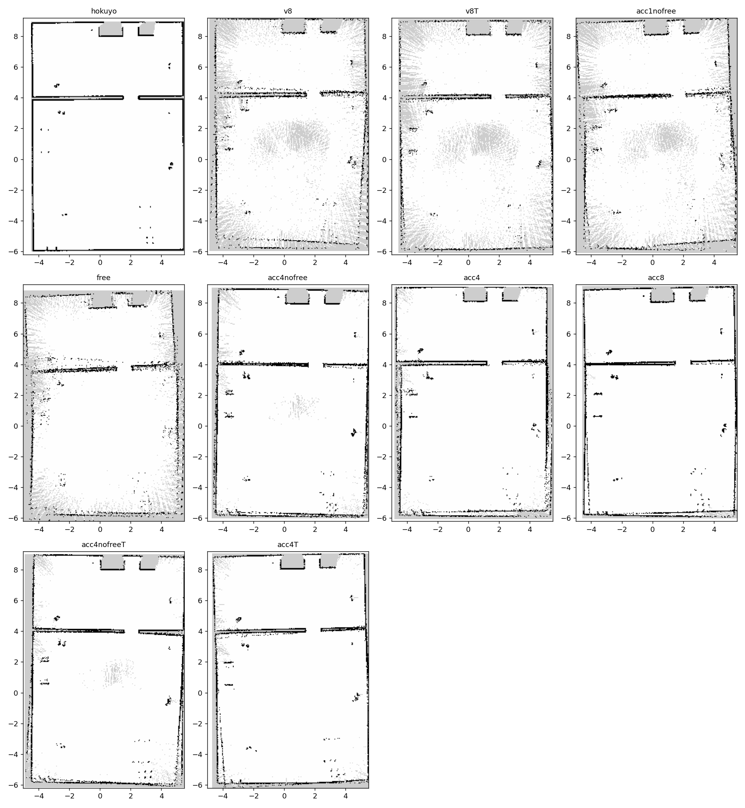
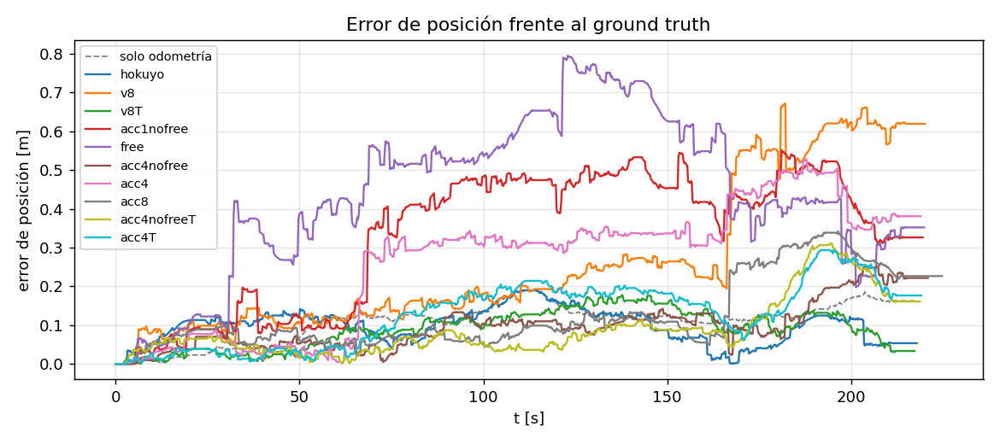
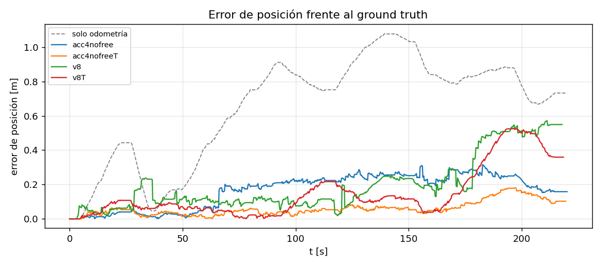
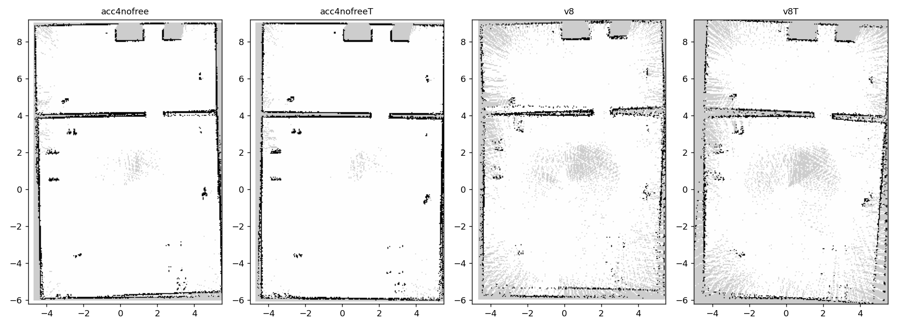

# Proyecto IA368 — Pepper: SLAM, entornos dinámicos e interacción por voz

Proyecto del curso **IA368 – Robótica** (Prof. Eric Rohmer), sobre la simulación de Pepper en
**ROS 2 Jazzy + Gazebo Harmonic** (Ubuntu 24.04).

La base del robot (modelo, sensores, mundos, slam_toolbox, Nav2, YOLO) está en
[`../Pepper-in-ROS2-Jazzy-and-Ubuntu-24`](../Pepper-in-ROS2-Jazzy-and-Ubuntu-24) y **no se
duplica aquí**: este repositorio sólo contiene lo nuevo del proyecto y reutiliza los launch y
configuraciones de la base.

| Fase | Objetivo | Estado |
|---|---|---|
| 1 | SLAM 2D con los **3 láseres bajos** de Pepper | ✅ primera versión (2026-10-15) |
| 2 | Objetos dinámicos en Gazebo (museo con personas en movimiento) | 🔄 entorno listo (2026-10-18); falta evaluar el SLAM |
| 3 | Un visitante llama a Pepper por voz → Pepper busca a la persona estática más cercana, se acerca y la mira | 🔄 clasificador de visitantes (97.7 %) y voz listos (2026-10-18); falta buscar, acercarse y mirar |

Presentación del proyecto (una pestaña por fase): [`docs/proyecto.html`](docs/proyecto.html),
publicada en **https://pepper-ia368.vercel.app**.

---

## Instalación

El workspace es `~/pepper_ws` (el mismo de la base). Esta carpeta se enlaza en `src/`:

```bash
ln -sfn ~/Robotica/Pepper-in-ROS2-Jazzy-and-Ubuntu-24 ~/pepper_ws/src/pepper     # base
ln -sfn ~/Robotica/2026-IA368II-Proyecto-Robotica    ~/pepper_ws/src/proyecto   # proyecto
cd ~/pepper_ws && colcon build --symlink-install
source install/setup.bash
```

---

## Fase 1 — SLAM con los 3 láseres de Pepper

### El problema

Pepper tiene tres láseres a ras de suelo (frontal, izquierdo y derecho), cada uno de **15 rayos
en ±30°** y hasta 7 m: 45 rayos en total, en tres sectores de 60° separados por huecos ciegos de
~30°. Es un sensor muy pobre para SLAM comparado con un lidar de 360°.

La base ya trae la fusión heredada del Tutorial V8 (`laser_publisher.py` → `/pepper/laser_2`),
y con ella slam_toolbox da un mapa reconocible pero punteado y con deriva. Analizando el código
de Karto (el motor de slam_toolbox, `karto_sdk/Karto.h`) se identificaron dos causas:

1. **Los rayos sin eco se publican como `NaN`, y Karto ignora los `NaN`.** El espacio libre sólo
   se marca a lo largo de los rayos que chocan con algo; en una sala grande la mayoría de los 45
   rayos no tocan nada y el mapa queda lleno de zonas grises "desconocidas".
2. **Cada scan tiene como mucho 45 puntos.** El scan matching tiene muy poca información y,
   cuando Pepper avanza paralelo a una pared larga, la posición a lo largo de la pared queda mal
   condicionada: el SLAM "salta" y aparecen paredes dobles.

### La solución: `pepper_multilaser_slam`

| Pieza | Qué hace |
|---|---|
| `scan_fusion` (nodo) | Fusiona los 3 láseres en `/pepper/scan_fused` (360°, 1°/rayo, en `base_footprint`) con **acumulación temporal** (y, opcional, marcado de **espacio libre**) |
| `config/slam_sparse_lasers.yaml` | Ajustes de slam_toolbox para sensores dispersos; se cargan **encima** de la configuración de la base (sólo los parámetros que cambian) |
| `slam.launch.py`, `fusion_slam.launch.py` | slam_toolbox (lifecycle) con la config de la base + overrides; fusión + SLAM |
| `route_driver` | Recorrido automático y repetible por la oficina (19 puntos, ~220 s, con cierre de lazo) |
| `trajectory_recorder` | Graba pose real (ground truth de Gazebo), pose del SLAM y odometría |
| `evaluate` | Métricas de trayectoria y de mapa, tablas y figuras |
| `scripts/run_experiment.sh` | Un experimento completo sin interfaz: simulación → SLAM → recorrido → mapa |
| `odom_noise` (nodo) | Odometría degradada con errores sistemáticos (`/pepper/odom_noisy`, árbol de TF aparte `odom_noisy → base_noisy`) para evaluar el SLAM con una odometría realista |
| `demo.launch.py` + `rviz/multilaser_slam.rviz` | Demo visual: Gazebo + fusión + SLAM + RViz con los 3 láseres en color + ruta automática |

**Acumulación temporal** (lo que se usa por defecto). Los impactos de los últimos N scans se
guardan en el frame `odom` y se reproyectan a la pose actual del robot. Con N = 4 (0.64 s a
6.25 Hz) la odometría apenas acumula error en ese intervalo y el scan pasa de ≤45 a ≤180 puntos.
Más rayos con eco también significa más espacio libre trazado en el mapa.

**Espacio libre** (opción `free_space`, desactivada: **resultado negativo**). Karto trata un rayo
así al construir el mapa (`OccupancyGrid::AddScan`): `NaN` o `≥ range_max` → se ignora; entre
`max_laser_range` y `range_max` → se traza como libre sin obstáculo al final. La idea era
publicar los rayos sin eco a 7.5 m (con `range_max = 8 m` y `max_laser_range = 7 m`) para que
limpien el espacio libre. Funciona en el mapa, pero los experimentos mostraron que **empeora la
localización**, y el código lo explica: el scan matcher (`GridIndexLookup::ComputeOffsets`) usa
`GetPointReadings()` **sin filtrar** y sólo descarta `NaN`/`inf`, así que esas lecturas entran al
matching como obstáculos falsos a 7.5 m. Con un único `LaserScan` no se puede tener las dos
cosas en Karto.

**Ajuste de slam_toolbox.** Karto penaliza alejarse de la odometría con
`1 − 0.2·d² / distance_variance_penalty`. Con el valor por defecto (0.5) un salto de 25 cm sólo
pierde un 2.5 % de respuesta; `slam_sparse_lasers.yaml` lo baja a 0.02 (un salto de 20 cm
pierde un 40 %), reduce la ventana de búsqueda a ±0.15 m y duplica el buffer de scans.

### Uso

Demo con un solo comando (Gazebo, SLAM, RViz y la ruta automática). En RViz: láser izquierdo
rojo, frontal verde, derecho azul, `/pepper/scan_fused` blanco:

```bash
ros2 launch pepper_multilaser_slam demo.launch.py                 # ruta automática
ros2 launch pepper_multilaser_slam demo.launch.py route:=false    # mover a mano (/pepper/cmd_vel)
ros2 launch pepper_multilaser_slam demo.launch.py gui:=false      # sin ventana de Gazebo
```

Por piezas:

```bash
# Terminal 1: simulación (paquete base)
ros2 launch pepper_gazebo_plugin pepper_gazebo_plugin_in_office_CPU.launch.py
# Terminal 2: fusión + SLAM
ros2 launch pepper_multilaser_slam fusion_slam.launch.py                 # acc4, sin espacio libre, Karto ajustado
ros2 launch pepper_multilaser_slam fusion_slam.launch.py accumulate:=1 free_space:=false overrides:=none
# Terminal 3: RViz2 con el mapa (paquete base)
ros2 launch pepper_gazebo_plugin pepper_sensors_rviz.launch.py config:=pepper_sensors_map.rviz
# Terminal 4: mover a Pepper (o la ruta automática)
ros2 run rqt_robot_steering rqt_robot_steering                           # topic /pepper/cmd_vel
ros2 run pepper_multilaser_slam route_driver --ros-args -p use_sim_time:=true
# Guardar el mapa
ros2 run nav2_map_server map_saver_cli -f mi_mapa
```

### Experimentos

```bash
S=$(ros2 pkg prefix pepper_multilaser_slam)/share/pepper_multilaser_slam/scripts/run_experiment.sh
$S v8 results/v8_r1                  # línea base: /pepper/laser_2 de la base
$S hokuyo results/hokuyo_r1          # cota superior: hokuyo "falso" de 720 rayos
$S acc4nofree results/acc4nofree_r1  # fusión nueva (4 scans acumulados)
TUNED=1 $S acc4nofree results/acc4nofreeT_r1   # ... y slam_toolbox ajustado (lo recomendado)
ros2 run pepper_multilaser_slam evaluate results/*_r* --out results
# Con odometría degradada (medio | alto): el SLAM usa /pepper/odom_noisy
ODOM_NOISE=alto TUNED=1 $S acc4nofree results/ruido_alto/acc4nofreeT_r1
```

Métricas (`evaluate`):

- **ATE RMSE**: error cuadrático medio de posición del SLAM frente al ground truth de Gazebo
  (`/pepper/odom_groundtruth`), alineando la primera pose. También se da el de la odometría sola.
- **Precisión del mapa**: % de celdas ocupadas a ≤10 cm de una pared del mapa de referencia
  (el del hokuyo, `pepper_gazebo_plugin/map/office.yaml`, en el mismo frame).
- **Completitud**: % de celdas ocupadas de la referencia con una celda ocupada a ≤10 cm.
- **Área libre** conocida en m².

### Resultados (2026-10-15)

Oficina con personas, misma ruta de 19 puntos (~220 s), **3 repeticiones** por configuración
(1 en las exploratorias). `T` = slam_toolbox con `slam_sparse_lasers.yaml`. Media ± desviación.
Tabla completa y por corrida en [`results/summary.md`](results/summary.md).

| Configuración | n | ATE RMSE [m] | Error final [m] | Precisión mapa (% ≤10 cm) | Completitud (% ≤10 cm) | Área libre [m²] |
|---|---|---|---|---|---|---|
| hokuyo (720 rayos, referencia) | 3 | 0.075 ± 0.029 | 0.042 ± 0.010 | 94.0 ± 10.4 | 95.9 ± 2.7 | 137.7 ± 0.2 |
| **v8** (`laser_2`, línea base) | 3 | 0.587 ± 0.483 | 0.924 ± 0.605 | 52.9 ± 12.9 | 62.1 ± 7.2 | 115.9 ± 1.5 |
| v8T | 3 | **0.098 ± 0.013** | 0.105 ± 0.065 | **90.8 ± 4.7** | 88.8 ± 2.4 | 116.8 ± 0.3 |
| acc4nofree | 3 | 0.163 ± 0.044 | 0.188 ± 0.057 | 79.3 ± 7.6 | 85.0 ± 9.2 | 134.0 ± 0.7 |
| **acc4nofreeT** (recomendado) | 3 | 0.135 ± 0.035 | 0.198 ± 0.066 | 76.7 ± 6.9 | **92.1 ± 5.6** | **134.4 ± 0.1** |
| acc4 (con espacio libre) | 3 | 0.306 ± 0.038 | 0.338 ± 0.051 | 60.3 ± 9.1 | 74.5 ± 6.5 | 134.4 ± 0.3 |
| acc4T (con espacio libre) | 3 | 0.131 ± 0.032 | 0.106 ± 0.061 | 78.4 ± 12.5 | 86.5 ± 4.2 | 136.4 ± 0.8 |
| acc1nofree | 1 | 0.374 | 0.326 | 57.8 | 63.0 | 116.8 |
| free (acc1 + espacio libre) | 1 | 0.477 | 0.352 | 33.6 | 49.1 | 118.7 |
| acc8 (con espacio libre) | 1 | 0.156 | 0.226 | 75.3 | 92.3 | 137.8 |

La odometría sola tiene un ATE de ~0.15 m en todas las corridas (el ruido simulado es pequeño).




**Conclusiones**

1. **La línea base del V8 es inestable**: ATE 0.59 ± 0.48 m. En las 3 corridas el scan
   matching "salta" en algún momento (paredes dobles), y queda peor que la odometría sola.
2. **Ajustar Karto es lo que más mejora la localización.** Con `slam_sparse_lasers.yaml` el
   mismo `laser_2` baja a 0.098 ± 0.013 m (6× mejor, y 5× menos variable), cerca del hokuyo.
   El problema no era sólo el sensor: con la configuración por defecto Karto casi no penaliza
   alejarse de la odometría.
3. **La acumulación temporal mejora el mapa**: el área libre pasa de ~116 m² a ~134 m² (el
   hokuyo da 138), desaparecen las zonas grises del centro de la sala y la completitud sube a
   92 %. Sin ajustar Karto, también estabiliza la localización (0.59 → 0.16 m).
4. **Marcar el espacio libre con lecturas finitas es contraproducente en Karto** (0.16 → 0.31 m
   sin ajustar), por cómo el scan matcher usa las lecturas sin filtrar (ver arriba).
5. **Configuración recomendada: `acc4nofreeT`** (lo que lanza `fusion_slam.launch.py` por
   defecto): mapa casi tan completo como el del hokuyo con sólo los 3 láseres reales de Pepper,
   y localización de ~0.13 m. Si sólo importa la trayectoria, `v8T` es algo más preciso
   (0.10 m) pero deja ~18 m² de la sala sin explorar en el mapa.

### Resultados con odometría degradada (2026-10-17)

Con el ruido de la simulación la odometría sola ya tiene ~0.15 m de ATE, y el SLAM apenas la
mejora. El plugin de la base sólo suma ruido blanco de media cero a la velocidad, que se promedia
al integrar. Un robot real deriva sobre todo por **errores sistemáticos**, así que `odom_noise`
los añade a cada incremento de la odometría, en el marco del robot:

| Nivel | Escala de avance | Escala de giro | Deriva de orientación |
|---|---|---|---|
| medio | +1.5 % | +2.5 % | 0.001 rad/s |
| alto | +3 % | +5 % | 0.002 rad/s |

(La ruta suma 47 m y 25 rad girados; los niveles se calibraron offline sobre trayectorias ya
grabadas.) La odometría degradada vive en un árbol de TF aparte (`odom_noisy → base_noisy`,
porque un frame no puede tener dos padres): el SLAM y la acumulación de `scan_fusion` sólo ven
esa odometría. Misma ruta, 3 repeticiones. Tablas por corrida en
[`results/ruido_alto/summary.md`](results/ruido_alto/summary.md) y
[`results/ruido_medio/summary.md`](results/ruido_medio/summary.md).

| Ruido | Configuración | ATE odometría sola [m] | ATE SLAM [m] | Error final [m] | Precisión mapa | Completitud | Área libre [m²] |
|---|---|---|---|---|---|---|---|
| alto | v8 | 0.814 ± 0.030 | 0.222 ± 0.053 | 0.416 ± 0.146 | 67.4 %¹ | 82.7 %¹ | 120.0¹ |
| alto | v8T | 0.780 ± 0.051 | 0.146 ± 0.058 | 0.210 ± 0.144 | 72.2 ± 5.0 | 78.4 ± 1.7 | 119.7 ± 0.8 |
| alto | acc4nofree | 0.762 ± 0.059 | 0.279 ± 0.148 | 0.385 ± 0.401 | 64.2 ± 1.2 | 75.4 ± 1.0 | 137.3 ± 3.2 |
| alto | **acc4nofreeT** | 0.779 ± 0.046 | **0.113 ± 0.052** | 0.207 ± 0.120 | **83.8 ± 2.7** | **98.6 ± 0.4** | 136.7 ± 1.3 |
| medio | v8T | 0.294 ± 0.027 | 0.145 ± 0.040 | 0.206 ± 0.044 | 76.1 ± 9.1 | 79.7 ± 7.9 | 117.6 ± 0.4 |
| medio | **acc4nofreeT** | 0.299 ± 0.080 | 0.144 ± 0.073 | 0.183 ± 0.094 | 73.1 ± 13.7 | 88.4 ± 15.1 | 135.2 ± 1.2 |

¹ Media de 2 corridas: en `v8_r3` `map_saver_cli` no recibió `/map` a tiempo (su trayectoria sí
es válida y entra en el ATE).




**Conclusiones con odometría degradada**

1. **El SLAM corrige la deriva**: con ruido alto la odometría sola acaba en ~0.78 m de ATE y
   `acc4nofreeT` en 0.11 m (7× menos). El SLAM mantiene ~0.11–0.15 m aunque la odometría
   empeore 5×, porque los láseres anclan la pose al mapa.
2. **El ajuste de Karto sigue ayudando con una odometría mala** (0.28 → 0.11 m con la fusión
   nueva, 0.22 → 0.15 m con `laser_2`). Penalizar los saltos no significa copiar la odometría:
   el scan matching sigue corrigiendo la deriva lenta y sólo se le impiden los saltos grandes
   y ambiguos.
3. **Con ruido alto la configuración recomendada es la mejor en todo**: menor ATE y el mejor mapa
   (98.6 % de completitud frente a 78 % de `v8T`, y ~17 m² más de área libre).
4. Con ruido medio `acc4nofreeT` y `v8T` empatan en trayectoria (0.14 m); la fusión nueva sigue
   dando un mapa más completo.

**Limitaciones**: 3 repeticiones por configuración; un solo entorno y una sola ruta; los errores
de odometría son un modelo (escala + deriva), no medidos en un Pepper real. La "precisión del
mapa" penaliza tanto el ruido como cualquier desplazamiento global del mapa respecto a la
referencia. La ruta se sigue con el ground truth (protocolo experimental: todas las
configuraciones recorren el mismo camino; el SLAM no lo ve).

**Siguientes pasos posibles**: más repeticiones y otra ruta; exploración autónoma (fronteras +
Nav2) en vez de la ruta fija; probar en el museo con gente en movimiento (Fase 2), donde la
acumulación puede dejar "estelas" de personas.

---

## Fase 2 — Museo con personas en movimiento

### Origen

Los mundos vienen del workspace de la tesis de graduación (`pepper_sim_ws`, ROS 1 + Gazebo
Classic: `pepper_virtual/pepper_gazebo_plugin/worlds/museum*.world` y sus launch
`pepper_gazebo_plugin_museum*.launch`). El paquete `pepper_museum` los porta a Gazebo Harmonic:

| Pieza | Qué es |
|---|---|
| `worlds/museum.sdf` | museo ISCAS vacío |
| `worlds/museum_with_people.sdf` | museo + 23 personas estáticas |
| `worlds/museum_with_people_moving.sdf` | museo + 10 personas estáticas + **16 actores caminando** con las trayectorias de la tesis (2–8 waypoints, 10–31 s, en bucle) |
| `worlds/museum_test_people.sdf` | museo + 4 de las personas estáticas, en sus posiciones de la tesis (prueba de la Fase 3) |
| `models/citizen_extras_female_03_fixed` | copia de `female_03` con texturas de nombre único (ver abajo) |
| `tools/museum_floorplan.py` → `maps/museum_walls.txt` | plano 2D: la malla del museo cortada a 20 cm del suelo, en celdas de 10 cm |
| `models/iscas_museum` | malla y texturas del museo (modelo "ISCAS Museum" de Changkun Chai, de la antigua base de modelos de Gazebo; no estaba en el workspace de la tesis, se tomó de una copia en GitHub, `COONEO/neor_mini`) |
| `models/actor_walk` | animación `walk.dae` de los actores (de `gazebosim/gazebo-classic`, `media/models`) |
| `tools/convert_worlds.py` | conversor de los `.world` de la tesis a `.sdf` de Harmonic (regenera `worlds/`) |
| `launch/museum.launch.py` | Pepper en el museo con el launch de la base; Pepper aparece en (-1.5, 1) como en la tesis |

Las personas estáticas (`citizen_extras_*`) son los modelos que ya trae la base.

```bash
ros2 launch pepper_museum museum.launch.py                              # personas en movimiento
ros2 launch pepper_museum museum.launch.py world:=museum_with_people    # personas estáticas
ros2 launch pepper_museum museum.launch.py world:=museum gui:=false     # vacío, sin interfaz
```

### Cambios respecto a Gazebo Classic

- **Sin `ActorCollisionsPlugin`.** En Classic los actores no tenían colisión y los láseres de
  rayos los atravesaban; el plugin les daba colisión. En Harmonic los láseres de Pepper son
  `gpu_lidar` (por render) y **ven la malla del actor** sin plugin: con Pepper quieto, los rayos
  que tocan a los actores cambian de distancia entre scans. Los actores no chocan físicamente
  con el robot.
- **Altura de los actores:** en Harmonic el origen de `walk.dae` está en la cadera; con z = 0
  (como en la tesis) quedaban hundidos hasta el pecho. El conversor suma 1 m a la z de cada
  waypoint, como los ejemplos de gz-sim.
- **Arranque lento:** la malla del museo (8 MB) y los actores hacen que el arranque vaya a
  RTF ~0.02 y el spawner de la base agota su timeout con `joint_state_controller`. El launch lo
  reintenta y lo activa (sin él no hay `/pepper/joint_states` ni TF de brazos y cabeza).
  Con la GPU funcionando (driver NVIDIA para el kernel 7.0.0-38), el museo con los 16 actores
  arranca en ~25 s y corre a **RTF ≈ 1.0**.
- **Texturas con el mismo nombre:** Harmonic reutiliza las texturas por nombre de archivo, y
  `citizen_extras_female_03` comparte nombres con `male_03` (cara ↔ camisa a cuadros) y con
  `female_02` (ropa ↔ vestido negro): se veía con la camisa en la cara y vestida de negro. El
  conversor usa la copia `citizen_extras_female_03_fixed`; el modelo de la base (también en la
  oficina) sigue igual.

**Pendiente**: SLAM (configuración de la Fase 1) en el museo con personas estáticas frente a
personas en movimiento: medir cuánto ensucian el mapa y la localización, y si la acumulación
deja "estelas".


---

## Fase 3 — Un visitante llama, Pepper acude

Hablar por el micrófono del PC representa a un visitante **cercano** que llama a Pepper para
preguntarle sobre el museo. Pepper debe buscar a su alrededor, elegir a la persona **estática**
más cercana (las que caminan son la dificultad de SLAM y navegación, no visitantes), acercarse a
~1 m y seguir mirándola hasta la siguiente pregunta. Si no hay nadie cerca, debe decirlo.

### Quiénes son los visitantes

Los mundos usan sólo tres modelos de persona, copiados: `male_03` (camisa a cuadros roja,
jeans), `female_02` (vestido negro) y `female_03` (chaqueta marrón, jeans). Las copias son
idénticas, así que la identidad es el modelo. La cara es mala señal en esta simulación (la
cabeza ocupa ~40 px a 2 m y ~25 px a 3 m, y Pepper a menudo ve a la gente de espaldas): el
reconocimiento usa el **cuerpo entero**, recortado por YOLO.

### Paquete `pepper_visitors`

| Pieza | Qué hace |
|---|---|
| `capture_dataset` | teletransporta a Pepper por el museo (`/world/default/set_pose`) y guarda la imagen de la cámara frontal + su pose ground truth |
| `tools/label_dataset.py` | YOLO11m detecta personas; cada caja se compara con la caja **proyectada** de cada visitante (pose de Pepper + cámara) → recorte etiquetado sin intervención. División por persona (test = visitantes que el modelo nunca vio) |
| `tools/train_classifier.py` | fine-tuning de `yolo11n-cls` (4 clases: 3 modelos + "otro" = actores) y línea base de color; pesos en `models/visitor_cls.pt` |
| `voice_listener` | micrófono (PipeWire) → frases por energía → Whisper large-v3-turbo en la GPU → `/pepper/voice/transcript` y, si hay palabra de llamada, `/pepper/visitor_call` |

```bash
# Dataset (con la simulación del museo corriendo con ese mundo)
ros2 run pepper_visitors capture_dataset --world museum_with_people --out datasets/visitors/raw/museum_with_people --n 900
ros2 run pepper_visitors capture_dataset --world museum_with_people_moving --out datasets/visitors/raw/museum_with_people_moving --n 400
# Etiquetado y entrenamiento (entorno de yolo_ros)
PY=~/pepper_ws/src/yolo_ros/yolo_ros/.venv/bin/python
$PY pepper_visitors/tools/label_dataset.py datasets/visitors/raw datasets/visitors/cls
$PY pepper_visitors/tools/train_classifier.py datasets/visitors/cls results/fase3/classifier
# Voz (usa ~/pepper_ws/venvs/voice: faster-whisper + CUDA 12)
ros2 run pepper_visitors voice_listener --ros-args -p device:=<node.name del micrófono en PipeWire>
```

El entorno de voz se crea con `uv venv --system-site-packages ~/pepper_ws/venvs/voice` e
instalando `faster-whisper nvidia-cublas-cu12 "nvidia-cudnn-cu12==9.*" brotli` (brotli propio
porque el del sistema es viejo para huggingface_hub).

### Resultados del clasificador (2026-10-18)

Dataset: 1300 capturas (900 con las 23 personas estáticas, 400 con los actores) → 2011 recortes
(train 1268, val 357, test 386). Test = 4 visitantes en sitios no vistos + actores.

| | Exactitud test | ≤ 2 m | 2–3.5 m | > 3.5 m | female_02 | female_03 | male_03 | otro |
|---|---|---|---|---|---|---|---|---|
| Línea base: histograma de color | 96.1 % | 100 % | 99.0 % | 92.5 % | 88.8 % | 100 % | 97.0 % | 97.6 % |
| **yolo11n-cls fine-tuning** | **97.7 %** | 98.6 % | 97.1 % | **97.7 %** | **98.9 %** | 96.0 % | 98.5 % | 97.6 % |

Con tres aspectos tan distintos, el color de la ropa ya acierta mucho; el fine-tuning se
justifica por la robustez **a distancia** (92.5 → 97.7 % a más de 3.5 m) y con el vestido negro.
Casi todos los errores son cajas con dos visitantes superpuestos; uno es un error de etiqueta
(un hombre estático marcado como actor). Métricas completas en `results/fase3/classifier/metrics.json`.

**Pendiente**: buscar (barrido de cabeza/cuerpo, descartar a quien se mueve, la más cercana con
la cámara de profundidad), acercarse con Nav2 (necesita el mapa del museo de la Fase 2) y
seguir mirando con `Head_controller`; probar la llamada con voz real.
